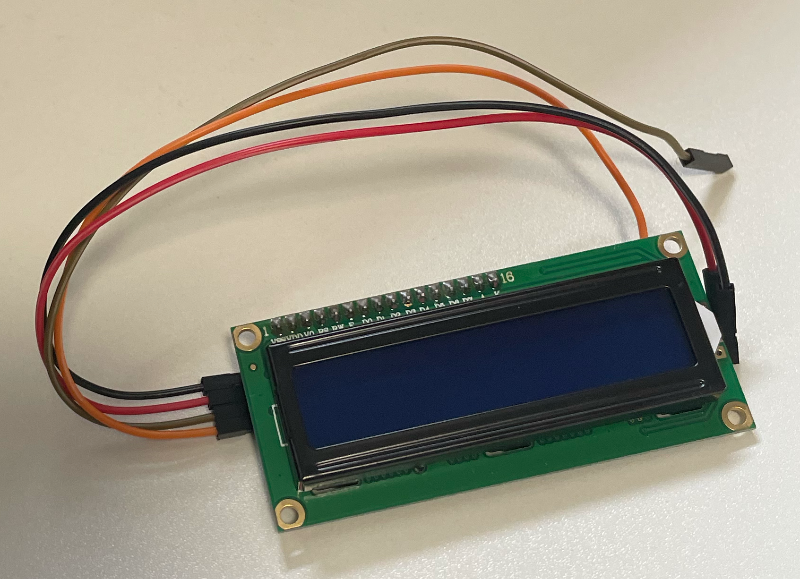

# ラズパイ講座 I2C通信 LCDに表示

**使用機材：** Raspberry Pi Compute Module 5（CM5）+ CM5 I/O Board  
**接続方法：** RaspberryConnect でリモートターミナル接続  
**使用パーツ：** I2C LCD 1602モジュール、ジャンパーワイヤー



---

## ⚠️ 危険事項（作業前に必ず確認すること）

| 禁止事項 | 理由 |
|---------|------|
| 5V（物理ピン2/4）をGPIOに接続しない | GPIOは3.3V動作。5V接続で即座に破損する |
| LCD の VCC に 5V を使う場合は GPIO に触れない | LCD自体は5V動作だが、信号線（SDA/SCL）は3.3Vのままにする |

> **Stage 1との違い：** Stage 1では GPIO2（物理ピン3）と GPIO3（物理ピン5）への配線を禁止した。  
> これらのピンはI2C通信専用の SDA・SCL ラインだったためで、スイッチやLEDをつなぐと内部バスが壊れる。  
> 今回は**I2Cデバイスとして正しく接続する**ので、GPIO2/3を使ってよい。

---

## インデックス

1. 導入・I2C通信とは
2. Step 1：I2Cの仕組みを理解する
3. Step 2：コマンドでI2Cデバイスを検出する
4. Step 3：Pythonプログラムを自分で考える
5. 動作確認・発展課題

---

## 導入

### 今回作るもの

**LCDディスプレイに文字を表示するプログラム**

ゴールの動作：
```
LCD上段: Hello, World!
LCD下段: Raspberry Pi
```

### I2C通信とは

これまでのGPIOはピン1本で1つの信号（ON/OFF）を送るだけだった。  
I2C（アイ・スクエア・シー）は**2本のワイヤーで複数のデバイスと通信できる**プロトコル。

| 信号線 | 名前 | 役割 |
|-------|------|------|
| SDA | Serial Data | データの送受信 |
| SCL | Serial Clock | タイミングの同期 |

複数のデバイスを同じ2本の線に繋ぎ、**アドレス**で相手を区別する。

```
CM5
 SDA ──┬── LCD（アドレス 0x27）
 SCL ──┤
       ├── センサー（アドレス 0x48）
       └── その他デバイス...
```

### 環境確認

```bash
# i2c-toolsが入っているか確認
which i2cdetect

# Pythonライブラリ確認
python3 -c "import smbus2; print('OK')"
```

---

## Step 1：I2Cの仕組みを理解する

### CM5のI2Cピン

| 信号 | BCM番号 | 物理ピン |
|------|---------|---------|
| SDA（データ） | GPIO2 | 物理ピン3 |
| SCL（クロック）| GPIO3 | 物理ピン5 |

> **なぜ Stage 1 で禁止していたか**  
> GPIO2/3 はI2Cバスの専用ピンで、常にプルアップされている。  
> ここにスイッチやLEDをつなぐとバスが壊れてシステムが止まる。  
> I2Cデバイスを接続する今回は、このピンを使うのが正しい。

### I2Cアドレスとは

I2Cデバイスにはそれぞれ固有の**7bitアドレス**（0x00〜0x7F）が割り当てられている。  
LCD 1602モジュールは通常 **0x27** か **0x3F**。

### 考えてみよう

**Q1. I2Cで2本の線だけで複数のデバイスと通信できるのはなぜか？**

**Q2. LCD 1602モジュールをSDA/SCLに接続するほかに、何の線が必要か？**

**Q3. LCDのアドレスを調べるにはどうすればよいか？**

---

## Step 2：コマンドでI2Cデバイスを検出する

### 配線する

LCD 1602 I2Cモジュールの端子：

| LCDの端子 | 接続先 | 物理ピン | 位置 |
|----------|-------|---------|------|
| GND | GND | **ピン6** | 偶数列・上から3番目 |
| VCC | 5V  | **ピン2** | 偶数列・上から1番目 |
| SDA | GPIO2 | **ピン3** | 奇数列・上から2番目 |
| SCL | GPIO3 | **ピン5** | 奇数列・上から3番目 |

> ⚠️ **4本のピンは連続していない。** LCDの端子順（GND・VCC・SDA・SCL）のまま上から刺そうとするとピンを間違える。1本ずつ位置を確認して接続すること。

```
物理ピン配置（上部抜粋）
奇数列  偶数列
  1: 3.3V  │  2: 5V   ← VCC
  3: SDA   │  4: 5V
  5: SCL   │  6: GND  ← GND
```

> ⚠️ VCCは5V（物理ピン2）に接続する。3.3Vでは動作しない場合がある。  
> SDA/SCLの信号線は3.3Vのままで問題ない。

### ① I2Cバスを確認する

```bash
ls /dev/i2c-*
```

`/dev/i2c-1` があれば使用可能。

### ② I2Cデバイスのアドレスを調べる

```bash
i2cdetect -y 1
```

出力例：
```
     0  1  2  3  4  5  6  7  8  9  a  b  c  d  e  f
00:                         -- -- -- -- -- -- -- -- --
10: -- -- -- -- -- -- -- -- -- -- -- -- -- -- -- -- --
20: -- -- -- -- -- -- -- 27 -- -- -- -- -- -- -- -- --
30: -- -- -- -- -- -- -- -- -- -- -- -- -- -- -- -- --
```

I2Cバス上の全アドレスをスキャンした結果。`--` はデバイスなし、数字はデバイスが応答したアドレスを表す。  
LCDの場合、`27`（= 0x27）または `3f`（= 0x3F）が表示される。

**確認したアドレス：** `0x＿＿＿`（後でプログラムに使う）

> **エラーが出た場合：** `Error: Could not open file '/dev/i2c-1'`  
> I2Cが有効化されていない。以下の手順で有効化して再起動する。
> ```bash
> sudo raspi-config
> ```
> `3 Interface Options` → `I5 I2C` → `Yes` → `Finish` → 再起動

### 確認チェックリスト

- [ ] `/dev/i2c-1` が存在する
- [ ] `i2cdetect -y 1` でLCDのアドレスが表示された
- [ ] アドレスをメモした（0x27 か 0x3F）

---

## Step 3：Pythonプログラムを自分で考える

### 使用するライブラリ

```bash
pip install RPLCD smbus2 --break-system-packages
```

### 使うクラス・メソッド

| コード | 内容 |
|-------|------|
| `CharLCD('PCF8574', 0x27)` | LCDオブジェクトを作成。アドレスは自分で確認した値を使う |
| `lcd.write_string('文字列')` | 文字を書き込む |
| `lcd.cursor_pos = (行, 列)` | カーソル位置を指定（行は0か1、列は0〜15） |
| `lcd.clear()` | 画面をクリアする |

インポート方法：

```python
from RPLCD.i2c import CharLCD
```

**ヒント**

`CharLCD('PCF8574', 0x27)` の意味：
- `'PCF8574'` ─ LCD裏面のI2Cエクスパンダーチップの型番（多くのLCDモジュールに使われている）
- `0x27` ─ i2cdetect で確認したアドレス

### 処理の流れを考えよう

```
[ 自分で埋めてみよう ]

1. CharLCD でLCDオブジェクトを作る
   - アドレスは i2cdetect で確認した値を使う

2. LCDの1行目に ____________ と表示する
3. カーソルを2行目の先頭に移動する
4. LCDの2行目に ____________ と表示する
```

### コーディング

```bash
nano lcd_hello.py
python3 lcd_hello.py
```

---

## 動作確認・発展課題

### 動作確認

- [ ] LCDに文字が表示された
- [ ] 1行目と2行目に別の文字が表示できた
- [ ] `lcd.clear()` で画面が消えた

---

### 発展課題

**課題A：カウントダウン表示**  
10からカウントダウンして0になったら「Go!」と表示する。

**課題B：時刻を表示する**  
Pythonの `datetime` モジュールを使い、現在時刻をLCDに表示する。

```python
from datetime import datetime
now = datetime.now()
now.strftime("%H:%M:%S")  # 例: "14:30:05"
```

**課題C：スクロール表示**  
`lcd.write_string()` に16文字を超える文字列を入れるとどうなるか試す。  
次に `lcd.shift_display(1)` で1文字ずつスクロールさせてみよう。

---

## 本日のまとめ

| 学んだこと | 内容 |
|-----------|------|
| I2C通信 | SDA・SCLの2線で複数デバイスと通信できる |
| I2Cアドレス | デバイスごとに固有の7bitアドレスがある |
| i2cdetect | バス上のデバイスとアドレスを確認するコマンド |
| RPLCD | PythonでLCDを制御するライブラリ |
| cursor_pos | カーソル位置を指定して文字を書く位置を変える |

---

*神戸テック ラズパイ講座 Stage 2 第1回*
