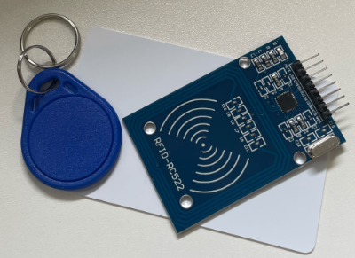

# ラズパイ講座 RFID カードリーダー アクセス制御システム

**使用機材：** Raspberry Pi Compute Module 5（CM5）+ CM5 I/O Board  
**接続方法：** RaspberryConnect でリモートターミナル接続  
**使用パーツ：** MFRC522 RFIDモジュール、MIFAREカード、タグ、I2C LCD（1602）



---

## インデックス

1. 導入・RFIDとは
2. Step 1：カードのUIDを読み取る
3. Step 2：登録済みUIDと照合する
4. Step 3：LCDに結果を表示する
5. 動作確認・発展課題

---

## 導入

### 今回作るもの

**カードをかざすと名前が表示されるアクセス制御システム**

ゴールの動作：
```
カードをかざす
 → UIDを読み取る
 → 登録済みUIDと照合する
 → 一致：LCDに「Welcome! + 名前」を表示
 → 不一致：LCDに「ACCESS DENIED」を表示
```

### RFIDとは

RFID（Radio Frequency IDentification）は、電波を使って非接触でデータを読み取る技術。

```
RFIDリーダー（電波を発生）
    ↕ 13.56MHz 電磁場
カード・タグ（電池不要・電波で動作）
```

**日常での使用例：** Suicaなどの交通系ICカード、社員証、マンションの鍵

### SPIとは（I2Cとの違い）

今回のMFRC522はSPI（Serial Peripheral Interface）で接続する。

| 項目 | I2C | SPI |
|------|-----|-----|
| 配線本数 | 2本（SDA/SCL） | 4本（MOSI/MISO/SCK/CS） |
| 速度 | 普通 | 高速 |
| 接続台数 | 複数 | CS1本につき1台 |
| 使用例 | LCD、センサー | カードリーダー、ディスプレイ |

### MFRC522 のピン構成

| ピン名 | 役割 | 接続先 |
|-------|------|-------|
| 3.3V | 電源（**3.3Vのみ**） | 物理ピン17 |
| GND | GND | 物理ピン20 |
| RST | リセット | GPIO25（物理ピン22） |
| SDA | チップセレクト（CS） | GPIO8（物理ピン24） |
| SCK | SPIクロック | GPIO11（物理ピン23） |
| MOSI | データ送信 | GPIO10（物理ピン19） |
| MISO | データ受信 | GPIO9（物理ピン21） |
| IRQ | 割り込み（**未使用**） | 接続しない |

> ⚠️ VCCは必ず **3.3V** に接続。5Vを繋ぐとモジュールが破損する。

---

## Step 1：カードのUIDを読み取る

### UIDとは

UID（Unique IDentifier）はカード・タグごとに固有の識別番号。  
製造時に割り当てられ、書き換えができない。人の指紋のようなもの。

### SPIを有効にする確認

```bash
ls /dev/spi*
```

`/dev/spidev0.0` が表示されることを確認する。

> 表示されない場合は `/boot/firmware/config.txt` の `dtparam=spi=on` を確認すること。

### 1-1：UIDを読み取るプログラム（動作サンプル）

```python
from mfrc522 import MFRC522

reader = MFRC522(bus=0, device=0)

print("カードをかざしてください（Ctrl+C で終了）")

while True:
    status, tag_type = reader.MFRC522_Request(reader.PICC_REQIDL)

    if status == reader.MI_OK:
        status, uid = reader.MFRC522_Anticoll()
        if status == reader.MI_OK:
            uid_str = "-".join([str(x) for x in uid])
            print(f"UID: {uid_str}")
```

```bash
nano uid_read.py
python3 uid_read.py
```

カードとキーホルダータグをそれぞれかざして、**それぞれのUIDをメモする**。

**Q1. カードとタグのUIDは同じか、異なるか？**

**Q2. 同じカードを2回かざすと、UIDは変わるか？**

---

## Step 2：登録済みUIDと照合する

### 辞書でUIDと名前を管理する

Pythonの辞書（`dict`）を使うと、UIDと名前の対応を管理できる：

```python
REGISTERED = {
    "123-45-67-89-0": "Alice",
    "98-76-54-32-1":  "Bob",
}
```

Step 1 でメモしたUIDをここに登録する。

### 2-1：照合プログラムを作る

```
[ 処理の流れを考えよう ]

1. 登録済みUID辞書を作る（Step 1 でメモしたUIDを使う）
2. カードをかざす
3. UIDを読み取る
4. そのUIDが辞書に含まれているか確認する
   → 含まれている：「Welcome! + 名前」を表示する
   → 含まれていない：「DENIED」を表示する
```

> ヒント：辞書に含まれるか確認するには `in` を使う
> ```python
> if uid_str in REGISTERED:
>     name = REGISTERED[uid_str]
> ```

```bash
nano uid_check.py
python3 uid_check.py
```

**Q3. 登録していないカード（辞書に未登録のUID）をかざすとどうなるか？**

---

## Step 3：LCDに結果を表示する

### LCD追加配線

| LCDピン | 接続先 | 物理ピン |
|--------|-------|:-------:|
| VCC | 5V | 2 |
| GND | GND | 9 |
| SDA | SDA | 3 |
| SCL | SCL | 5 |

> I2Cアドレス確認：`i2cdetect -y 1`

### 表示設計

```
一致時：                  不一致時：
行1：  Welcome!           行1：  ACCESS
行2：   Alice             行2：   DENIED

待機中：
行1：  Ready...
行2：  Scan card
```

### 3-1：完成プログラムを作る

```
[ 処理の流れを考えよう ]

1. RFIDリーダー・LCD・UIDの辞書を初期化する
2. LCDに待機メッセージ（"Ready... / Scan card"）を表示する
3. ループ：
   a. カードを検知する
   b. UIDを読み取る
   c. 辞書と照合する
      → 一致：LCDに「Welcome! + 名前」を2秒間表示
      → 不一致：LCDに「ACCESS / DENIED」を2秒間表示
   d. 待機メッセージに戻す
```

```bash
nano access_control.py
python3 access_control.py
```

カード・タグをかざして正しく動作するか確認する。

---

## 動作確認・発展課題

### 動作確認

- [ ] UIDが読み取れた
- [ ] カードとタグのUIDが異なることを確認した
- [ ] 登録済みカードで「Welcome!」が表示された
- [ ] 未登録カードで「DENIED」が表示された
- [ ] 待機メッセージに戻った

---

### 発展課題

**課題A：入室回数をカウントする**  
カードをかざすたびに「入室回数」をカウントし、LCDの2行目に `Count: 5` のように表示しよう。

**課題B：カードを登録するモードを作る**  
まず「登録カード」をかざすと登録モードに入り、次のカードを新しいユーザーとして辞書に追加するプログラムを作ろう。

**課題C：LEDと組み合わせる**  
一致時に緑LED点灯、不一致時に赤LED点灯するプログラムを作ろう。

**課題D：ファイルにUIDを保存する**  
プログラムを終了してもUIDの登録が残るよう、`json` モジュールを使ってファイルに保存・読み込みするプログラムを作ろう。

---

## 本日のまとめ

| 学んだこと | 内容 |
|-----------|------|
| RFIDの仕組み | 電波でカードのUIDを非接触で読み取る |
| SPI接続 | I2Cより高速な4線シリアル通信 |
| UID | カードごとに固有の識別番号 |
| 辞書（dict） | UIDと名前の対応をPythonで管理する |

---

*神戸テック ラズパイ講座 RFID カードリーダー アクセス制御システム*
