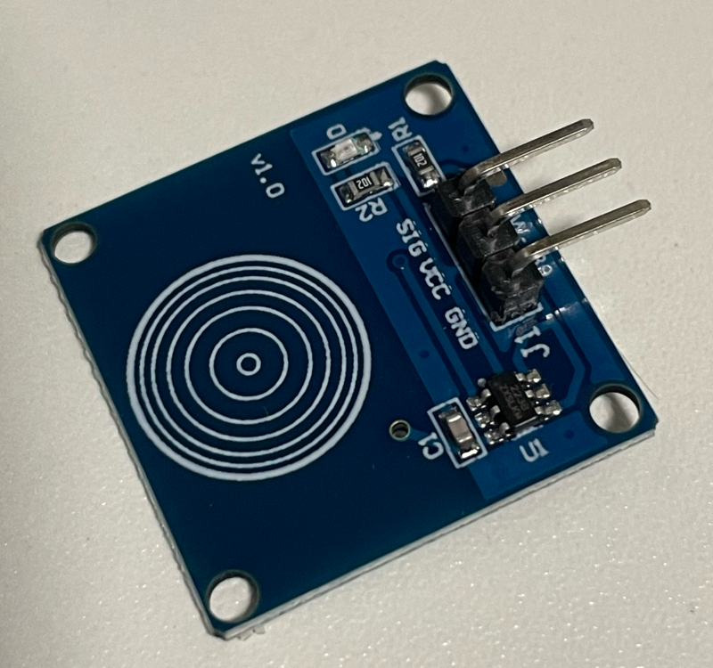

# ラズパイ講座 タッチセンサー（静電容量式）

**使用機材：** Raspberry Pi Compute Module 5（CM5）+ CM5 I/O Board  
**接続方法：** RaspberryConnect でリモートターミナル接続  
**使用パーツ：** タッチセンサーモジュール（例：TTP223搭載モジュール）、LED、抵抗（330Ω）、ジャンパーワイヤー


    
---

## ⚠️ 危険事項

| 禁止事項 | 理由 |
|---------|------|
| GPIO2（物理ピン3）・GPIO3（物理ピン5）に配線しない | CM5内部のI2C通信バスに接続されており、システムがハングする |
| 5V（物理ピン2/4）をGPIOに直接接続しない | GPIOは3.3V動作。5V接続で破損する可能性がある |

---

## インデックス

1. 導入・タッチセンサーとは
2. 端子（ピン）の説明
3. 接続ガイド
4. 注意点
5. 動作しなかった場合の確認方法
6. 動作確認・まとめ

---

## 導入

### タッチセンサーとは

タッチセンサー（静電容量式タッチスイッチ）は、指で触れることで回路の静電容量の変化を検知し、ON/OFFの信号を出力するモジュール。タクトスイッチのような機械的な可動部品がなく、触れるだけで反応する。

```
指で触れる（静電容量が変化）→ タッチセンサー → ラズパイに HIGH/LOW を送る
```

**日常での使用例：** タッチ式照明スイッチ、エレベーターのボタン、家電の操作パネル

多くのモジュールは `TTP223` などのタッチ検出ICを使っており、見た目は違ってもピン構成（VCC / GND / 信号出力）は共通していることが多い。

---

## 端子（ピン）の説明

タッチセンサーモジュールには通常3本のピンがある。**この3本すべてを接続して初めて正しく動作する。**

| 役割 | 意味 | 代表的な表記例 |
|------|------|---------------|
| 電源(+) | モジュールに電力を供給する | `VCC` `V` `+` |
| グラウンド | 電源の基準（0V）。電源(+)とセットで必ず接続する | `GND` `G` `-` |
| 信号出力 | 触れた/触れていないを表すデジタル信号 | `OUT` `SIG` `S` `I/O` |

> **重要：** 表記はメーカー・ロットによってバラバラで統一されていない。**基板に印刷されている文字を必ず確認すること。**
>

---

## 接続ガイド

### 配線

| タッチセンサー | 接続先 | ラズパイ物理ピン |
|--------------|-------|:---------------:|
| VCC | 3.3V | 1 |
| GND | GND | 6 |
| SIG（OUT） | GPIO5（空いている任意のGPIO） | 29 |

```
物理ピン1（3.3V）  → タッチセンサー VCC
物理ピン6（GND）   → タッチセンサー GND
物理ピン29（GPIO5）← タッチセンサー SIG
```

> VCCは **3.3V〜5V** に対応するモジュールが多いが、ラズパイのGPIOは3.3V入力までしか耐えられない。**VCCは3.3V（物理ピン1）側に接続するのが安全。**

### コマンドで動作確認する
`pinctrl set 5 ip`はGPIO 5番ピンを入力（Input）モードに設定する  
`pinctrl get 5`はGPIO 5番ピンの現在の設定や電圧レベルを取得・確認

```bash
pinctrl set 5 ip
pinctrl get 5
```

**触れていない状態：**
```
5: ip  pd | lo
```

**触れた状態：**
```
5: ip  pd | hi
```

### Pythonでの読み取り（gpiozero）

タッチセンサーはON/OFFの2値を返すだけなので、タクトスイッチと同じ `Button` クラスで扱える。

```python
import os
os.environ['GPIOZERO_PIN_FACTORY'] = 'lgpio'

from gpiozero import Button
from signal import pause

touch = Button(5)

touch.when_pressed = lambda: print("触れた！")
touch.when_released = lambda: print("離した")

print("監視中（Ctrl+C で終了）")
pause()
```

### 考えてみよう

**Q1. `pinctrl set 5 ip pd` の `pd` は何を意味するか？**

Pull-Down（プルダウン）の略です。内部のプルダウン抵抗を有効にし、外部から何も信号が加わっていない（オープンな）状態のときに、ピンの電圧が確実にLow（0V）になるよう安定させます。

---

## 注意点

| 項目 | 内容 |
|------|------|
| 電源電圧 | 多くのモジュールは2.0V〜5.5V程度に対応するが、GPIOへ直接信号を入れる場合はVCCを3.3V側にする |
| グラウンド基準 | 静電容量式センサーは、触れる人の体とセンサー回路の間に共通の基準電位（グラウンド）がないと、正しく検知できないことがある。アースを取っていないUSB電源などで動作が不安定な場合はこれが原因の可能性がある |
| 動作モード | モジュールによっては「触れている間だけON（モーメンタリ）」と「1回触れるとON/OFFが切り替わる（トグル／ラッチ）」の2種類がある。配線前に挙動を確認すること |
| 感度・誤検知 | 基板表面の汚れ・湿気・金属の近接で誤検知することがある |

---

## 動作しなかった場合の確認方法

配線通りに繋いだのに反応がない（常にHIGH、または常にLOWで変化しない）場合、「ラズパイ側の問題」なのか「センサー自体の故障」なのかを切り分ける必要がある。故障を疑って一つずつ検証していくこと自体も、電子工作における重要な学習プロセスである。

### 切り分けの考え方

```
反応しない
 │
 ├─ ① GPIO側の設定を疑う
 │    pinctrl set <pin> ip pd で明示的に入力モード・プルダウンに設定したか？
 │
 ├─ ② 配線を疑う
 │    VCC・GND・SIGが正しいピンに刺さっているか？（ラベルを再確認）
 │
 └─ ③ センサー自体を疑う
      → ラズパイを使わない単体テストで検証する
```

### 単体LEDテスト（ラズパイを使わない検証）

ラズパイのGPIO設定やコードを完全に排除し、センサー単体の良否だけを確認する方法。ブレッドボードは配線の組み立てに使ってよい。

**配線：**

```
センサー VCC  → 3.3V電源
センサー GND  → GND
センサー SIG  → 330Ω抵抗 → LED(+)
LED(-)        → GND
```

電源はラズパイの3.3V・GNDピンを使ってよいが、信号はGPIOを経由させず、SIGから直接LEDへ繋ぐ。

**確認手順：**

1. 配線後、数秒待ってLEDの状態を見る（触れていない状態で消灯しているか）
2. パッドに触れてLEDが点灯するか確認する
3. 手を離してLEDが消灯するか確認する（トグルモードの場合はもう一度触れて消灯するか確認）

**結果の見方：**

| LEDの挙動 | 考えられる原因 |
|----------|---------------|
| 触れると点灯・離すと消灯する | センサーは正常。問題はラズパイ側の配線・設定にある |
| 常に消灯・常に点灯したまま、触れても変化しない | センサー故障（出力が固定されている）の可能性が高い |
| 触れると点灯するが、離しても消灯しない | トグル（ラッチ）モードの可能性。再度触れて消灯するか確認する。何度触れても解除されない場合はセンサー故障 |

---

## まとめ

| 学んだこと | 内容 |
|-----------|------|
| タッチセンサーの仕組み | 静電容量の変化でHIGH/LOWを出力する |
| ピン表記の確認 | メーカーによってラベルが異なるため、必ず基板の印字を確認する |
| 切り分けの手法 | ラズパイを使わない単体テストで、ソフト／配線／ハードの問題を分離できる |

---

*神戸テック ラズパイ講座 タッチセンサー（静電容量式）*
